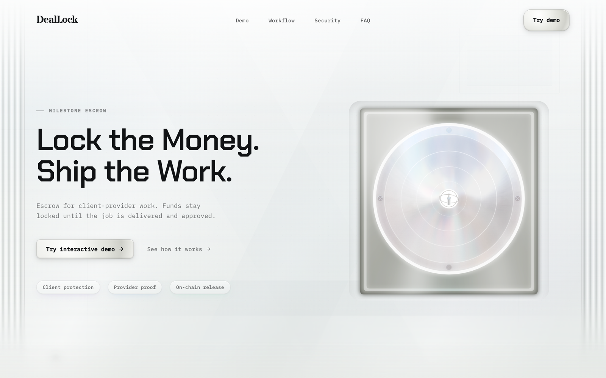
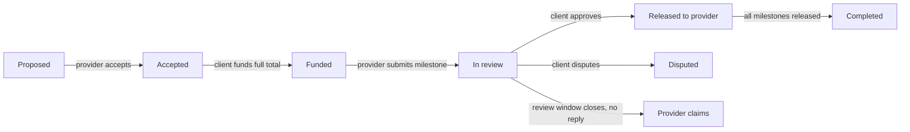
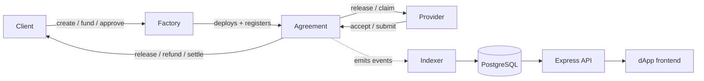

# DealLock

**Milestone-based escrow for client–freelancer work.** A client locks the full payment in
a smart contract up front; each milestone is released only when the client approves the
work. No platform fee, no custodian, no middleman — just contract-enforced rules that both
sides can read before they commit a cent.



**[▶ Live demo](https://deallock-demo.vercel.app)** · **[Showcase source](showcase/)** · **[Contract mechanics](docs/contract-mechanics.md)** · **[Testing](docs/testing.md)**

> The live demo is a public, browser-only **simulation** — no wallet, no account, no
> backend, and no real funds. Every amount and event is clearly labelled “Simulated”.

---

## Two surfaces

DealLock is two distinct things in one repository.

**1. Interactive showcase** — [`showcase/`](showcase/) is a frontend-only demonstration of
the escrow workflow you can drive from either side of a deal. It is deterministic and
client-side, with **no wallet, no backend, no chain calls, and no real money**. This is
what the live demo serves, and it builds with nothing but Node and a browser.

**2. Protocol implementation** — [`contracts/`](contracts/), [`backend/`](backend/), and
[`frontend/`](frontend/) are the actual engineering: Solidity escrow contracts with a full
Hardhat test suite, plus a testnet-oriented dApp and an Express/Prisma backend prototype
(wallet-signature auth, a contract-event indexer, notification emails). This is where the
real escrow logic lives.

The showcase mirrors the contracts' behaviour exactly but shares none of their runtime — so
you can explore the product without a wallet, and read the engineering without running a
node.

## How the escrow works

A deal follows one path, and the location of the money is always explicit:



At every step the contract tracks four amounts — **total committed**, **locked in escrow**,
**already released**, and the **pending** milestone — plus exactly **who acts next**. The
interactive demo shows those numbers updating live as you move through the flow.

What the contracts enforce, on-chain:

- **Acceptance before funding.** The provider must accept the terms before the client can
  fund — so nobody works against an unfunded promise, and nobody funds a deal the provider
  hasn't agreed to.
- **All-at-once funding.** The client deposits the full agreement total in one move; funds
  then release milestone by milestone.
- **Sequential milestones.** A milestone can be submitted or approved only once every
  earlier one is released or settled. Approval is always manual — there is no automatic
  payout.
- **A review window per agreement** (bounded 1 hour–14 days; there is no fixed default).
  Submitted work can be approved, disputed, or — if the client goes silent — claimed by
  the provider once the window closes.
- **Refunds for missed deadlines.** A still-pending milestone can be refunded to the client
  after its deadline plus a short grace window. Submitted work cannot be clawed back.
- **Revisions & deadline extensions** on the latest contract (V6): the client can request a
  revision instead of approving, and the provider can request more time — which only takes
  effect if the client accepts.
- **Disputes resolve by mutual settlement only.** Disputed funds freeze and move solely
  when both parties accept a proposed split. There is no arbiter, no automatic winner, and
  no timeout that releases them — so resolution requires agreement.
- **No fees, no admin, no backdoor.** The full milestone amount goes to the provider on
  release; neither side (and no owner) can withdraw locked funds at will.
- **Payment assets:** native ETH, or one fixed ERC-20 per agreement (e.g. USDC) on the
  multi-asset contracts. Fee-on-transfer / rebasing tokens are rejected by a balance-delta
  check.

There are six contract versions (V1–V6) and three factories; the version axis, ABI
switching, and the exact dispute/deadline rules are documented in
**[docs/contract-mechanics.md](docs/contract-mechanics.md)**.

## Architecture

Blockchain reads are the source of truth; the backend and emails are off-chain
conveniences layered on top.



- **Contracts** — Solidity 0.8.20 on Hardhat 3. New agreements deploy through
  `DealLockFactoryV3` (V6 multi-asset), with Factory V2 / legacy fallbacks. Factories only
  deploy and register agreements — they never hold funds, take fees, or control a deal.
- **Backend** — Express 4 + Prisma 6 + PostgreSQL: wallet-signature sign-in, multi-wallet
  accounts, and a two-phase event indexer (factory discovery + per-agreement lifecycle)
  guarded by a PostgreSQL advisory lock, with indexed notification emails.
- **Frontend** — React 19 + Vite 6 + TypeScript; auto-detects the on-chain contract version
  and switches ABI accordingly.
- **Showcase** — the same React/Vite stack reduced to the landing page + demo, with the
  entire wallet/backend layer removed from the build.

## Tests & reproducibility

GitHub Actions runs on every push and pull request to `main`: **Contracts** (solhint +
Hardhat tests), **Backend** (PostgreSQL-backed), **Indexer integration** (against a live
Hardhat node), **Frontend** build, and **Showcase** (install + build + simulator tests).

```bash
npm test                                 # all Hardhat contract/factory tests
npm run release:check                    # full local gate (contracts + backend + indexer + frontend)
cd showcase && npm ci && npm test && npm run build   # demo: reducer invariants + build
```

The showcase ships [invariant tests](showcase/src/components/landing/demo/demoModel.test.ts)
for the escrow simulator's reducer (no funding before acceptance, sequential milestones,
conserved escrow math, the revision path, no impossible states) so the demo can't quietly
drift from the contract behaviour it claims to show. See **[docs/testing.md](docs/testing.md)**.
These are local and CI checks — no figures in this repository are third-party audited.

## Security

- **Showcase** (`showcase/`) — five runtime dependencies (React, React DOM, React Router,
  Spline) and a zero-dependency test setup. `npm audit` reports **0 vulnerabilities**, and
  no wallet / backend / chain code is reachable in the shipped bundle.
- **Full application** (`frontend/`, `backend/`) — the full dApp carries the older web3
  stack (wagmi / viem / WalletConnect / TanStack Query), whose dependency tree currently
  has **known advisories (dozens, several high-severity)**. It is intended for local and
  testnet development, **not** public deployment; treat its security status separately from
  the showcase.

The contracts have a Hardhat test suite but **no external security audit**. Do not deploy
them to a mainnet or custody real funds without an independent review.

## License

**Business Source License 1.1** — see [`LICENSE`](LICENSE). The Licensed Work is **not**
open source today; it converts to the **MIT License on 2030-04-29**. Commercial use before
the change date requires a separate license from the licensor named in the file.

---

*DealLock is an independent portfolio project, not affiliated with any third party and
making no guarantees to any. The 3D scenes are the author's own Spline assets; all other
assets are original to this project.*
