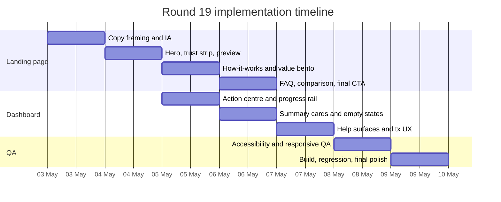

# Round 19 spec for DealLock landing page and dashboard

## Executive summary

I benchmarked 50 startup pages as a design-research set: 20 established leaders across fintech, AI, devtools, productivity, trust/compliance, and web3, plus 30 recent YC launch/company pages that show the newest AI-first copy and UX patterns. Across that set, the strongest pages win the first viewport by doing four things quickly: they state the outcome in plain language, show the product immediately, establish trust before the user has to infer it, and give a low-friction next step. The clearest examples are Stripe, Linear, Vercel, Notion, Clay, Gamma, and Cursor for product-first clarity and preview; and Vanta, Coinbase, Privy, and Dynamic for trust-first messaging in high-risk categories. citeturn5search0turn6search0turn6search1turn7search0turn15search1turn19search0turn15search0turn32search1turn27search1turn8search0turn8search1

For DealLock, the implication is straightforward: the landing page should stop leading with crypto mechanics and start leading with protection, clarity, and “what happens next”. The hero should explain the product as milestone escrow for client work, not as a web3 primitive. The page should show the agreement UI in the first viewport, add a short trust strip, explain the workflow in three steps, and handle the main objections explicitly: where funds live, who can release them, whether non-crypto users can understand it, and what happens during revisions or disputes. The dashboard should feel like a compact command centre: current state, next action, agreement progress, value-at-a-glance, trust indicators, and contextual help. This is closer to the best parts of Stripe, Brex, Mercury, Vanta, Privy, and Alchemy than to a generic crypto dashboard. citeturn5search0turn5search6turn28search7turn32search4turn8search0turn8search10turn5search10turn5search14turn28search3

A second important finding is that the frontier AI startups do not usually try to sound grand; they sound sharp. Their copy is usually a wedge, not a manifesto: “AWS for AI agents”, “Cursor for DevOps”, “AI-native legal services for startups”, “Product onboarding that builds itself”, “Turn more website visitors into customers”. The best of these pages compress category, user, and benefit into a single fast hook. DealLock does not need to mimic their tone, but it should borrow their precision. citeturn14search2turn2search10turn12search1turn13search3turn14search5

## Research methodology

This benchmark set was built from official company homepages, official YC company pages, official Launch YC pages, and official investor/company pages from Sequoia, Accel, a16z, Menlo, and Index. Where a live homepage snippet did not surface cleanly in search, I used the company’s official YC or investor page as the primary analysed page, because those pages usually expose the clearest one-line positioning and backing status. I also pulled a small number of official docs and case-study style sources for dashboard and onboarding patterns, including Vercel’s dashboard redesign, PostHog’s activation/template material, Linear’s start guide, Mercury’s startup guide, and Vanta’s Trust Center implementation material. citeturn10search15turn0search1turn11search3turn11search16turn18search1turn22search11turn29search14turn20search0turn28search6turn28search1turn28search3turn32search10

The sample is intentionally not a league table of “best companies”. It is a design benchmark set weighted for relevance to DealLock’s problem: non-crypto-savvy clients and freelancers need a landing page that communicates safety, control, and sequence; and a dashboard that reduces cognitive load around money, milestones, approvals, revisions, and disputes. That is why the analysis overweights AI/SaaS/fintech/web3 products with strong onboarding, trust, and workflow UX rather than purely visual showpieces.

I used the following decision criteria when extracting patterns:

| Criterion | What I looked for | Why it matters for DealLock |
|---|---|---|
| Hero clarity | Can a first-time visitor explain the product after 5 seconds? | DealLock must reduce crypto anxiety immediately. |
| Product preview | Is there a meaningful visual preview above or near the fold? | Users need to see the agreement/milestone model, not imagine it. |
| Trust proof | Are safety, control, governance, or compliance surfaced early? | DealLock sits in the “money + trust + workflow” category. |
| CTA architecture | Is there a clear primary action and a sensible secondary action? | Visitors need both a conversion path and a learning path. |
| Feature packaging | Are features grouped by use case rather than by internal architecture? | DealLock has to explain milestones, revisions, disputes, and assets simply. |
| Onboarding to activation | Does the product guide new users to first value? | Round 19 should connect landing + dashboard to first successful agreement. |
| Dashboard actionability | Does the home screen tell the user what to do now? | Contract workflows stall when state and responsibility are unclear. |
| Help and empty states | Are there templates, examples, glossary, tutorials, or shortcuts? | Non-crypto users need local explanations, not only docs elsewhere. |

## Benchmark set

The tables below are the 50 analysed reference pages. The first table is the durable benchmark set of established winners; the second table is the frontier set of recent YC launches and company pages that show newer AI-first positioning patterns.

**Established reference set**

| Name | Primary analysed page | YC/VC status | One-line positioning | Why it matters |
|---|---|---:|---|---|
| Stripe | `stripe.com` | YC S09 | Economic infrastructure for the internet; financial infrastructure to grow your revenue | Benchmark for fintech clarity, proof-led navigation, and excellent primary/secondary CTA design. citeturn17search0turn5search0 |
| Brex | `brex.com` | YC W17 | AI-powered spend platform for modern companies | Strong benchmark for quantified proof, finance automation language, and dashboard/home shortcuts. citeturn17search15turn5search6turn5search10 |
| Replit | `replit.com` | YC company | Collaborative in-browser IDE; apps and sites with AI | Good model for fast activation, live product preview, and “build with natural language” clarity. citeturn26search0turn6search10 |
| Zapier | `zapier.com` | YC S12 | Automate AI workflows, agents, and apps | Excellent benchmark for information architecture, use-case categorisation, and no-code activation language. citeturn26search11turn27search0 |
| Coinbase | `coinbase.com` | YC S12 | Secure platform for buying, selling, transferring, and storing cryptocurrency | Useful trust benchmark for making crypto feel plain, regulated, and approachable. citeturn26search22turn27search1 |
| Kalshi | `kalshi.com` | YC W19 | Regulated exchange and prediction market for real-world events | Strong example of “regulated/trusted/institutional” framing in a novel financial category. citeturn26search8turn27search6 |
| Speak | `speak.com` | YC W17 | AI language tutor that gets you speaking | Strong consumer benchmark for simple outcome-first messaging and low-jargon design. citeturn24search3turn27search3 |
| Retool | `retool.com` | YC company | Build internal software better, with AI | Good reference for enterprise credibility, “production-ready” proof, and business-use-case framing. citeturn24search0turn9search3 |
| PostHog | `posthog.com` | YC W20 | Platform to build, test, measure, and ship products faster | Particularly relevant for onboarding templates, activation thinking, and product-led empty states. citeturn17search8turn6search11turn28search2turn28search6 |
| Airbyte | `airbyte.com` | YC company | Open data movement platform for the AI era | Useful for feature-bento structure and clear “layer/infrastructure” page architecture. citeturn17search3turn7search3 |
| Vanta | `vanta.com` | YC W18; Sequoia-backed | Automated compliance and trust management platform | Best benchmark in the set for early trust, security proof, and branded transparency surfaces. citeturn32search6turn32search4turn32search7 |
| Ramp | `ramp.com` | Sequoia-backed | Spend management, corporate cards, and accounts payable in one platform | Excellent model for finance operations copy, operational focus, and action-oriented dashboard language. citeturn31search0turn5search1 |
| Linear | `linear.app` | Sequoia-backed | Product development system for teams and agents | Gold-standard reference for premium minimalism, product-first hero, and action-led workflow UX. citeturn11search0turn6search0turn28search1 |
| Vercel | `vercel.com` | Accel-backed | Build and deploy on the AI Cloud | Great benchmark for strong above-the-fold proof, interactive preview, and a clear dashboard information hierarchy. citeturn11search1turn6search1turn20search0 |
| Cursor | `cursor.com` | a16z-backed | The best way to code with AI | Strong reference for interactive first-view demo, concise copy, and premium motion restraint. citeturn18search3turn15search0 |
| Notion | `notion.so` | Sequoia-backed | AI workspace; connected workspace for wiki, docs, and projects | Strong reference for “all-in-one” framing, modular product architecture, and workflow-based proof. citeturn29search15turn7search0 |
| Figma | `figma.com` | Index/a16z-backed | Design platform for teams who build products together | Good benchmark for collaborative-product storytelling, design-system credibility, and polished feature packaging. citeturn29search11turn7search9 |
| Anthropic | `anthropic.com` | Menlo-backed | AI for problem solvers; space to think | Valuable tone benchmark: calm, safe, high-trust, and not over-hyped. citeturn22search19turn4search5 |
| Clay | `clay.com` | Sequoia-backed | Tools that help businesses grow with data and AI workflows | Useful for use-case segmentation, audience specificity, and personalised outbound/landing concepts. citeturn30search0turn15search1 |
| Privy | `privy.io` | Sequoia-backed | Wallet infrastructure built for scale; unlock crypto rails | Best web3 benchmark here for explaining security model and usability in plain English. citeturn33search4turn8search0 |

**Recent YC / frontier set**

| Name | Primary analysed page | YC/VC status | One-line positioning | Why it matters |
|---|---|---:|---|---|
| Blaze | `blaze.money` | YC S24 | Global Venmo for cross-border payments | Great shorthand example: familiar metaphor + clear wedge. citeturn2search1 |
| TamLabs | `ycombinator.com/companies/tamlabs` | YC W25 | AI for professional services | Good vertical-AI language: clear buyer and category. citeturn2search4 |
| StarSling | `ycombinator.com/companies/starsling` | YC company | Cursor for DevOps; self-driving CI | Excellent category shorthand and measurable systems wedge. citeturn2search10 |
| Arcline | `arcline-ai.com` | YC Launch | AI-native legal services for startups | Strong service-plus-software framing with same-day-turnaround promise. citeturn12search1 |
| Selfin | `selfin.app` | YC Launch | First AI bank; all-in-one financial platform | Strong “all your finances in one place” framing relevant to money anxiety. citeturn12search4 |
| Finto | `gofinto.com` | YC Launch | AI accounting software for enterprise finance teams | Excellent benchmark for concrete workflow copy: inbox to ERP. citeturn12search5 |
| Roark | `ycombinator.com/launches/Mnq` | YC Launch | Observability and testing platform for voice AI | Clear buyer/problem framing without vague platform talk. citeturn12search6 |
| Cozmo AI | `ycombinator.com/launches/PUt` | YC Launch | System of work for enterprises in financial services and insurance | Strong regulated-industry AI language with explicit operational outcomes. citeturn12search7 |
| Kita | `ycombinator.com/launches/PEj` | YC W26 Launch | Turn financial documents into risk signals for lenders | Good benchmark for document-to-decision clarity. citeturn12search10 |
| Freya | `ycombinator.com/launches/O9R` | YC Launch | Voice AI agents for financial services | Strong example of compliance-aware AI messaging. citeturn12search16 |
| Blaxel | `ycombinator.com/launches/Neo` | YC Launch | AWS for AI agents | Best-in-class shorthand hook for infrastructure positioning. citeturn14search2 |
| Sherpa | `withsherpa.ai` | YC Launch | Turn more website visitors into customers | Very relevant benchmark for conversion-first marketing-site language. citeturn14search5 |
| Laminar | `lmnr.ai` | YC Launch | Open-source observability and analytics for complex LLM apps | Strong reliability and analytics positioning for technical buyers. citeturn14search8 |
| Inari | `ycombinator.com/launches/JCX` | YC Launch | AI-powered customer insights hub | Good benchmark for “consolidate noisy sources into insight” copy. citeturn14search11 |
| Trellus | `ycombinator.com/launches/PSN` | YC Launch | Parallel dialer inside Attio; AI sales coach | Strong workflow-native wedge: lives where the user already works. citeturn14search13 |
| DiligenceSquared | `ycombinator.com/launches/Om9` | YC Launch | AI-powered market due diligence for investment decisions | Strong proof of auditable-output positioning in a trust-heavy category. citeturn14search14 |
| Surface Labs | `ycombinator.com/launches/LAg` | YC Launch | AI that turns leads into customers | Useful for full-funnel conversion framing. citeturn14search18 |
| Aditto | `ycombinator.com/launches/MFs` | YC Launch | Launch search engine marketing with one click | Good example of speed-to-value promise. citeturn14search21 |
| Unusual | `unusual.ai` | YC Launch | AI-generated websites for each visitor | Relevant for role/personalisation thinking on DealLock’s landing page. citeturn14search16 |
| OpenFunnel | `ycombinator.com/launches/M8t` | YC Launch | GTM agents for developer tools | Strong niche-first category definition. citeturn13search12 |
| Hyperbrowser | `hyperbrowser.ai` | YC Launch | Connecting AI to the web in 2 minutes with MCP | Good benchmark for sharp time-to-value developer copy. citeturn13search18 |
| Tecto | `ycombinator.com/launches/Nxc` | YC Launch | Governance platform for AI employees | Useful benchmark for monitoring, policy, and compliance messaging. citeturn13search8 |
| Frigade | `ycombinator.com/launches/Owy` | YC Launch | Product onboarding that builds itself | Highly relevant to DealLock’s first-run experience and in-app guidance. citeturn13search3 |
| Vellum | `ycombinator.com/launches/PAb` | YC Launch | Vellum for agents | Another strong shorthand example: user + category + task. citeturn13search4 |
| Fulcrum | `fulcrumresearch.ai` | YC Launch | Agentic debugger for AI systems | Strong metaphor-led framing; translates complexity into a familiar tool. citeturn14search17 |
| Onlook | `ycombinator.com/launches/Mkl` | YC Launch | Cursor for designers | Useful crossover benchmark for designer/developer product storytelling. citeturn16search18 |
| Alloy | `ycombinator.com/launches/OiU` | YC Launch | AI prototyping for product managers | Good benchmark for prototype-first messaging. citeturn16search13 |
| Avoice | `avoice.co` | YC Launch | Harvey for architecture | Short, memorable vertical-AI positioning. citeturn16search10 |
| Asteroid | `ycombinator.com/launches/MtY` | YC Launch | Browser agents with human oversight | Particularly relevant benchmark for human approval in risky actions. citeturn13search14 |
| Inspector | `ycombinator.com/launches/Opr` | YC Launch | AI IDE for front-end | Good benchmark for domain-specific positioning and workflow pain storytelling. citeturn13search2 |

This 50-page set points to two simultaneous truths. Mature leaders optimise for clarity, trust, and product proof; frontier YC launches optimise for sharp category shorthand, clear wedges, and time-to-value. DealLock needs both. It should borrow maturity from Stripe, Vanta, Linear, Brex, Mercury, and Coinbase; and precision from Sherpa, Frigade, Blaxel, StarSling, Arcline, and Unusual. citeturn5search0turn32search4turn6search0turn5search6turn28search7turn27search1turn14search5turn13search3turn14search2turn2search10turn12search1turn14search16

## Common patterns and their implications for DealLock

The clearest landing pages are not merely “beautiful”; they are information-efficient. They remove ambiguity faster than average, and they do it with fewer words.

| Market pattern | Representative examples | Why it works | DealLock adaptation |
|---|---|---|---|
| Outcome-first hero, not technology-first hero | Stripe, Ramp, Linear, Speak, Plaid. citeturn5search0turn31search0turn6search0turn27search3turn9search0 | Users buy the result before they buy the mechanism. | Headline should lead with protection and milestones, not “smart contracts” or “web3 escrow”. |
| Product preview in or near the first viewport | Linear, Cursor, Vercel, Replit, Gamma. citeturn6search0turn15search0turn6search1turn6search10turn19search0 | Seeing the shape of the product reduces cognitive load and perceived risk. | Show a real or realistic agreement-detail preview with milestones, status, and next action. |
| Primary CTA + lower-pressure secondary CTA | Stripe, Vercel, Gamma, Carta. citeturn5search0turn6search1turn19search0turn9search5 | Serious buyers want a path to act and a path to learn. | Primary CTA: create/start protected project. Secondary CTA: see how it works / view sample agreement. |
| Trust proof above the fold | Vanta, Coinbase, Privy, Dynamic, Kalshi. citeturn32search4turn27search1turn8search0turn8search1turn27search6 | High-risk categories must establish control, security, and legitimacy early. | Add a compact trust strip: no platform custody, wallet-authorised actions, ETH + USDC, revisions/disputes, no platform fees. |
| Feature packaging by use case, not by backend architecture | Notion, Clay, Airbyte, Mercury, Vanta. citeturn7search0turn15search1turn7search3turn28search7turn32search4 | Buyers understand workflows, not implementation layers. | Replace generic feature cards with role/use-case cards: create milestones, fund safely, approve/release, request revisions, raise dispute, follow activity. |
| Explicit promise of fast time-to-value | Mercury, Vercel, Zapier, Cursor quickstart, Bolt quickstart. citeturn5search3turn6search21turn27search0turn15search12turn19search19 | Time-to-value reduces abandonment. | Promise a simple first run: create or open first agreement in minutes, with guided help. |
| Personalisation or persona routing | Clay, Mercury vertical pages, Speak for Business, Sherpa, Unusual. citeturn15search11turn28search13turn27search19turn14search5turn14search16 | Users engage faster when the product talks in their context. | Use a role switcher: “I’m hiring” / “I’m delivering work”. Adapt proof and CTAs by role. |
| Objection handling built into the page | Vanta Trust Center, Privy secure-by-design, Coinbase trust framing, Kalshi regulated framing. citeturn32search7turn8search20turn27search1turn27search18 | Trust categories die when objections are deferred to support. | FAQ must answer custody, approval, disputes, supported assets, and “do I need to be crypto-native?”. |
| Frontier copy uses sharp shorthand | Blaxel, StarSling, Onlook, Avoice, Blaze. citeturn14search2turn2search10turn16search18turn16search10turn2search1 | Fast category formation beats abstract language. | DealLock can use shorthand lightly in section labels, but hero should remain plain and trust-first. |
| Blank-page elimination is now a conversion pattern | Gamma, Framer AI, Replit, Bolt. citeturn19search0turn19search3turn6search10turn19search2 | AI-era products reduce activation friction by starting users from a first draft. | Landing page and dashboard should give users a sample agreement path, not only “start from scratch”. |

The strongest copy hooks across the set are also strikingly consistent:

| Copy hook type | Market examples | Best DealLock version |
|---|---|---|
| Outcome + domain | “Financial infrastructure to grow your revenue”, “The product development system for teams and agents”. citeturn5search0turn6search0 | “Milestone escrow for client work.” |
| All-in-one simplification | “Everything you do with money. All in one place.”, “The AI workspace that works for you.” citeturn5search3turn7search0 | “Create, fund, review, and release work in one clear flow.” |
| Trust superlative | “Most trusted platform”, “new standard for trust”. citeturn27search5turn32search1 | “Funds stay in the contract until work is approved.” |
| Fast activation | “Apply in 10 minutes”, “deploy in seconds”, “get setup in 9 minutes”. citeturn5search3turn6search21turn8search0 | “Open your first protected agreement in minutes.” |
| Built for a persona | “For startups”, “for marketing teams”, “for business”. citeturn28search18turn15search11turn27search19 | “For clients who need control. For freelancers who need payment certainty.” |
| Workflow promise | “from inbox to ERP”, “track, plan, and deliver”, “build, automate, and scale”. citeturn12search5turn28search1turn27search0 | “Set milestones, fund safely, release on approval, and handle revisions without guesswork.” |

The dashboard patterns are equally consistent. The best dashboards are not data walls; they are prioritisation engines.

| Dashboard pattern | Representative examples | Why it works | DealLock adaptation |
|---|---|---|---|
| Overview cards with balance/health/activity | Brex home page, Mercury dashboard, Privy Home, Alchemy Dashboard. citeturn5search10turn28search3turn8search16turn8search10 | Gives instant orientation without forcing deep navigation. | Show escrowed, releasable, released, and pending-transaction state at a glance. |
| Action centre / highest-priority reminder | Brex alerting on tiles; Vercel dashboard redesign. citeturn5search14turn20search0 | Users need one next step, not ten equal-weight widgets. | Add a single highest-priority “Next step” card based on role + agreement state. |
| Role-aware onboarding path | Linear Start Guide, PostHog onboarding hypotheses, Vercel getting started. citeturn28search1turn28search6turn28search4 | Activation improves when setup is sequenced. | Add a first-run checklist tied to “create or open your first agreement”. |
| Templates and empty-state help | PostHog templates, Gamma templates, Bolt quickstart. citeturn28search2turn19search13turn19search19 | Empty states become instructional surfaces. | Empty dashboard should offer a simple starter path and one sample agreement concept. |
| Contextual shortcuts | Brex home shortcuts, Mercury “Move Money”, Linear issue flows. citeturn5search10turn28search3turn28search11 | Shortcuts keep work moving from the home screen. | Add shortcuts for create agreement, copy contract address, view role guide, open glossary. |
| Activity feed with meaningful status updates | Brex recent activity, Linear Slack/state sync. citeturn5search10turn28search14 | Users trust stateful systems when history is readable. | Keep the improved activity feed, but group around milestone stages and pending actions. |
| Trust and transparency surface | Vanta Trust Center, Dynamic security layers, Privy policy model. citeturn32search7turn8search1turn8search20 | Trust improves when control surfaces are visible. | Add a “How this agreement is protected” panel with contract/network/status facts. |
| Contextual implementation/tutorial help | Vanta 30-60-90 guide, PostHog onboarding success plan, Cursor Learn. citeturn32search10turn28search12turn15search8 | Guidance inside the product beats sending people away. | Reuse Round 18 glossary/role components as inline help, not as an orphan section. |
| Transaction status state machine | Alchemy dashboard monitoring, Privy balances/transactions, finance-support flows. citeturn8search10turn8search16turn28search22 | Money-related actions need explicit, non-ambiguous state transitions. | Add visible states for awaiting signature, submitted, confirming, confirmed, failed, with explorer links if available. |

For DealLock, the best synthesis is: landing page like Stripe + Vanta + Coinbase (calm trust and clarity), dashboard like Brex + Mercury + Alchemy (action centre + finance state + operational transparency), onboarding like Frigade + PostHog + Linear (first-value sequencing and local help). citeturn5search0turn32search4turn27search1turn5search10turn28search3turn8search10turn13search3turn28search6turn28search1

## Round 19 specification

Round 19 should be a frontend-only, trust-first, conversion-oriented redesign pass focused on the public landing page and the signed-in dashboard. It should not change Solidity, backend, indexer, auth model, or payment logic. It should reuse the onboarding foundation from Round 18 and make it visible in the right contexts.

### Landing page target architecture

The landing page should be restructured into six sections in this order:

1. **Hero split**
   - Left: headline, subhead, CTA pair, role switcher.
   - Right: product preview of an agreement with milestones, status, and release/revision flow.
   - Directly below: compact trust strip.

2. **Three-step “How it works”**
   - Create agreement.
   - Fund milestone.
   - Release on approval or continue with revision/dispute path.

3. **Role-specific value bento**
   - For clients: budget control, milestone release, audit trail.
   - For freelancers/providers: payment certainty, reduced chasing, clear approval path.

4. **Product proof block**
   - Annotated screenshot(s) of dashboard/agreement view.
   - Explain what users can see: current state, next action, activity log, funds in contract.

5. **Objection handling**
   - “Why not bank transfer / upfront invoice / private wallet transfer?”
   - FAQ: who holds funds, what is USDC, what happens if work changes, what if there is a dispute, do I need to know crypto.

6. **Final CTA**
   - Primary conversion path.
   - Secondary learning path.
   - Role-specific subtext.

### Dashboard target architecture

The dashboard should become a home screen that prioritises the next action over generic overview blocks.

1. **Top action row**
   - Current agreement state badge.
   - Plain-English sentence: “Waiting for client to fund milestone 1” / “Review requested” / “Funds released”.
   - Highest-priority CTA.

2. **Progress rail**
   - Draft → Funded → In progress → Review → Released / Refunded / Disputed.
   - Use actual product states where they exist; do not invent unsupported states.

3. **Value summary cards**
   - Escrowed.
   - Releasable now.
   - Released so far.
   - Pending transaction / next key event.

4. **Onboarding/help block**
   - Checklist for first-time users.
   - Inline glossary/help link.
   - Role guide card.

5. **Activity and transaction area**
   - Friendly activity log.
   - Current tx status banner when relevant.
   - Explorer link if already available in product.

6. **Trust/transparency panel**
   - Contract/network facts.
   - Wallet-authorised action statement.
   - “Funds live in the contract” reminder.
   - Link to FAQ/help.

### Prioritised task list

| Priority | Task | Acceptance criteria | Effort | Risk note |
|---|---|---|---:|---|
| P0 | Reframe hero around outcome and trust | First viewport states what DealLock is, who it is for, and why it is safer than informal payment flows. Includes role switcher, CTA pair, trust strip, and product preview. No overflow at 375px. | M | Risk of over-jargon. Keep crypto terms secondary. |
| P0 | Add annotated product preview | Hero or immediate next section shows a realistic agreement-detail preview with milestone timeline, state label, and clear next action. Use real UI or frontend-only mock based on real UI patterns. | M | Do not fake unsupported features. |
| P0 | Build a 3-step “How it works” section | Section must explain create → fund → approve/release (with revision/dispute note) in plain English. Must mention ETH/USDC only if those are actually supported. | S | Avoid legal over-promising about disputes. |
| P0 | Add trust strip and proof section | Trust strip must include only truthful product claims. Example: no platform custody, wallet-authorised actions, milestones, ETH/USDC, revisions/disputes, no platform fees. | S | Never invent compliance badges, audits, or testimonials. |
| P0 | Add dashboard action centre | Home/dashboard shows exactly one highest-priority next step per relevant agreement or account state. Includes CTA, secondary help link, and consequence/context sentence. | M | Priority logic must map to real states only. |
| P0 | Add agreement progress rail + summary cards | Dashboard includes progress component and value cards for escrowed / releasable / released / pending state. Works for both empty and populated states. | M | If a metric is unavailable, omit it rather than fake it. |
| P0 | Reuse onboarding components in-context | Existing RoleGuide and ConceptGlossary are accessible from landing and dashboard help surfaces, not buried. | S | Avoid dumping too much tutorial text into the hero. |
| P1 | Add FAQ and objection-handling section | At least 6 concise questions answered in plain English, including custody, release, supported assets, revisions, disputes, and whether users need crypto knowledge. | S | Answers must mirror actual product behaviour. |
| P1 | Improve dashboard empty states | First-time dashboard shows starter checklist and sample first action, not a dead end. Empty-state copy must differ for signed-out, wallet-connected, and no-agreement states. | M | Do not overwhelm with too many cards. |
| P1 | Improve transaction UX surface | Pending actions render a top-level status banner with state transitions such as awaiting signature, submitted, confirming, confirmed, failed. Use icon + text, not colour alone. | M | Must not conflict with wallet library behaviour. |
| P1 | Strengthen activity-feed scannability | Activity feed supports clearer grouping and better state/event wording. Keep product-language mapping from Round 18. | S | Avoid duplication with the new action centre. |
| P2 | Add optional sample-agreement path | If feasible without backend work, allow visitors to view a static/read-only sample agreement flow from landing page. | L | Treat as optional if routing or data shape makes it unsafe. |
| P2 | Add comparison section | A short “Why DealLock instead of upfront invoice or wallet transfer?” section appears on landing page. | S | Stay factual; avoid attacking specific competitors. |
| P2 | Final polish pass | Tight spacing, visual hierarchy, iconography consistency, motion restraint, and uniform token usage. | M | Avoid regressions in dark mode and milestone pills. |

### Acceptance rules for Claude

Claude should treat the following as hard constraints for Round 19:

- **No stack migration.** Keep the existing React + Vite + TypeScript + wagmi + viem stack.
- **No backend/contract/indexer logic changes.** Frontend and content only.
- **No fake social proof.** If there are no real logos, testimonials, or usage metrics, use product-truth proof instead.
- **No jargon-first copy.** “USDC” and “wallet” may appear, but after the plain-English explanation.
- **No trust theatre.** Do not add badges or claims that do not exist.
- **No hard-coded colour regressions.** Use the token system only.
- **No conversion trap.** The landing page primary CTA should not feel like a forced wallet pop-up with no explanation.
- **No motion dependency.** Any visual motion must degrade gracefully and respect reduced-motion preferences.

### Mermaid milestone timeline

## Implementation notes for Claude

### Visual and accessibility constraints

The visual direction should be **minimal, premium, and trust-heavy**. Borrow the composure of Linear and Anthropic, the product proof of Vercel and Cursor, and the trust surfaces of Vanta, Coinbase, and Privy. Avoid overusing crypto neon tropes or decorative effects that reduce perceived seriousness. citeturn6search0turn4search5turn6search1turn15search0turn32search4turn27search1turn8search0

The implementation should meet the following frontend constraints:

| Constraint | Requirement |
|---|---|
| Contrast | WCAG 2.2 AA minimum for body text and key functional labels. |
| Focus states | Visible keyboard focus on all CTAs, tabs, accordions, chips, links, and transaction actions. |
| Motion | Respect `prefers-reduced-motion`; no essential information may depend on animation. |
| Colour usage | Never rely on colour alone for milestone or tx state meaning. Add icon/text redundancy. |
| Hit targets | Touch targets at least 44×44px. |
| Status updates | Use semantic status patterns and `aria-live` where transaction states change. |
| Tokens | All colours, spacing, radii, shadows, and text sizes should come from the existing token system. |
| Images/media | Optimise hero/product visuals; use poster frames or lightweight motion, not heavy autoplay video. |
| Dark mode | Preserve the dark-first aesthetic, but ensure the hierarchy reads cleanly on mobile and desktop. |

### Sample microcopy

The benchmark set shows that DealLock should use shorter, more literal copy. The following examples are intentionally sharper and less “web3-native”.

| Surface | Recommended copy |
|---|---|
| Hero headline | **Milestone escrow for client work** |
| Hero subhead | Create agreements, fund milestones in ETH or USDC, and release payment only when work is approved. Funds stay in the contract until the workflow says they move. |
| Primary CTA | **Create an agreement** |
| Secondary CTA | **See how it works** |
| Role switcher | **I’m hiring** / **I’m delivering work** |
| Trust strip item | **No platform custody** |
| Trust strip item | **Wallet-authorised actions only** |
| Trust strip item | **Milestone-based payouts** |
| Trust strip item | **ETH and USDC** |
| Trust strip item | **Revisions and disputes supported** |
| Dashboard action title | **Next step** |
| Dashboard action helper | **What happens after this?** |
| Empty state title | **No agreements yet** |
| Empty state body | Start with a simple milestone agreement to protect budget, timeline, and payout from day one. |
| Help card title | **Need this in plain English?** |
| Help card body | Open the 2-minute guide for clients and providers. |
| FAQ item | **Where does the money go after funding?** |
| FAQ answer | Into the contract for this agreement — not to DealLock, and not to the provider until the required approval path is completed. |

### CTA variants worth testing

| Context | Variant A | Variant B | Variant C |
|---|---|---|---|
| Hero primary | Create an agreement | Start protected project | Open your first escrow |
| Hero secondary | See how it works | View a sample agreement | Learn the 3-step flow |
| Final CTA | Protect your next project | Start with milestone escrow | Create your first protected agreement |
| Dashboard first action | Create agreement | Open agreement workspace | Start protected deal |

### File and component plan

The exact paths may differ in the repo, but the implementation should roughly map to the following structure:

| Path | Change |
|---|---|
| `frontend/src/pages/LandingPage.tsx` | Rebuild section order, hero, trust strip, proof block, FAQ, final CTA. |
| `frontend/src/pages/DashboardPage.tsx` | Add action centre, progress rail, summary cards, help surfaces, better empty states. |
| `frontend/src/components/layout/AppShell.tsx` | Support new top-level dashboard action/status area if needed. |
| `frontend/src/components/onboarding/RoleGuide.tsx` | Reuse in landing and dashboard help. |
| `frontend/src/components/onboarding/ConceptGlossary.tsx` | Expose via help card, drawer, or accordion. |
| `frontend/src/components/activity/ActivityFeed.tsx` | Improve grouping/scannability if this component already exists. |
| `frontend/src/components/landing/HeroSplit.tsx` | New: hero layout with role switcher and preview. |
| `frontend/src/components/landing/TrustStrip.tsx` | New: compact trust banner using existing tokens. |
| `frontend/src/components/landing/HowItWorks.tsx` | New: 3-step flow. |
| `frontend/src/components/landing/ValueBento.tsx` | New: role-specific value cards. |
| `frontend/src/components/landing/ProductProof.tsx` | New: screenshot/annotation section. |
| `frontend/src/components/landing/FAQAccordion.tsx` | New: objections and answers. |
| `frontend/src/components/dashboard/ActionCenter.tsx` | New: highest-priority next action card. |
| `frontend/src/components/dashboard/ProgressRail.tsx` | New: agreement lifecycle bar. |
| `frontend/src/components/dashboard/ValueSummaryGrid.tsx` | New: escrowed / releasable / released / pending cards. |
| `frontend/src/components/dashboard/OnboardingChecklist.tsx` | New or adapted: first-run checklist. |
| `frontend/src/components/dashboard/TrustPanel.tsx` | New: contract/network/transparency facts. |
| `frontend/src/components/dashboard/TransactionStatusBanner.tsx` | New: pending/confirmed/failed transaction surface. |
| `frontend/src/styles/tokens.css` or theme equivalent | Extend only if required; do not hard-code colours. |
| `frontend/src/styles/*.css` or component CSS modules | Add only the styles necessary for these new components. |

### Test and QA checklist

Claude should run or validate the following after implementation:

| Check | Required result |
|---|---|
| `npm run build` | Must pass cleanly. |
| `npm run lint` if configured | No new lint failures. |
| `npm run test` if configured | No broken frontend tests. |
| Desktop QA | Hero reads cleanly at 1280px and 1440px. |
| Mobile QA | No overflow or unreadable preview at 375px width. |
| Empty state QA | Signed-out, wallet-connected/no-agreement, and active-agreement states all render meaningful guidance. |
| State QA | Review/funded/released/revision/dispute states remain visually coherent. |
| Keyboard QA | Entire landing page and dashboard core flow is keyboard navigable. |
| Reduced motion QA | Motion is optional and disabled where requested. |
| Contrast QA | Trust strip, pills, muted text, and dashboard cards remain legible in dark mode. |

### Final instruction block for Claude

Implement Round 19 as a **frontend-only conversion and trust pass**. The landing page should explain DealLock in plain English, show the product early, and reduce objection load for non-crypto-savvy clients and freelancers. The dashboard should become an action-oriented home screen that tells the user what to do next, where funds are in the workflow, and how to understand the current agreement state. Reuse Round 18 onboarding primitives; do not invent unsupported business logic, fake metrics, or fake compliance claims. Prioritise outcome clarity, trust signals, role-specific guidance, accessibility, and responsive polish over decorative complexity.